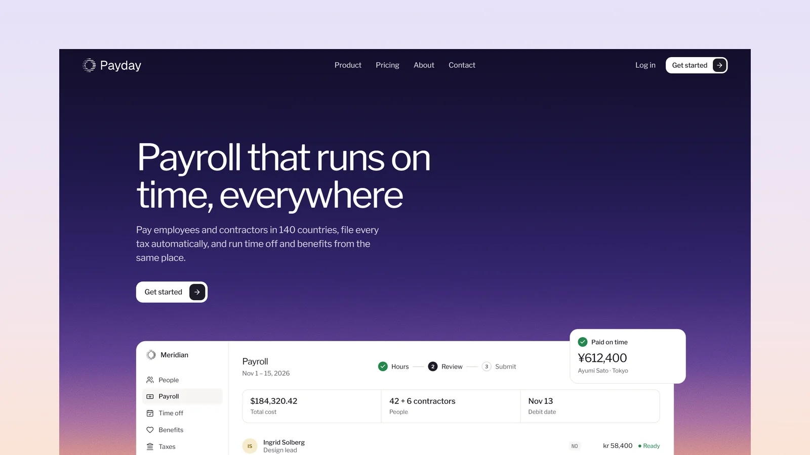

# Payday - Astro Theme for SaaS and Product Sites

[](https://payday.xocoweb.workers.dev/)

[](https://astro.build/)
[](https://tailwindcss.com/)
[](https://www.typescriptlang.org/)
[](./LICENSE)

**Live preview:** https://payday.xocoweb.workers.dev/

Payday is a free Astro theme for SaaS and product sites. Its demo is a global payroll product, told on one long landing page with grainy gradients and quiet product UI built in HTML and CSS.

## Features

- A long landing page, an about page, and a contact page
- A full-bleed grainy gradient hero under a transparent header, with a payroll app built in HTML and CSS
- A logo marquee that pauses on hover
- Keyboard-accessible tabs, each with its own product panel
- A global payroll table over a pastel gradient
- Stats and a customer quote
- A bordered feature grid with six small product mockups
- Pricing with a monthly and yearly toggle in CSS alone
- Customer story cards on grainy gradients
- An FAQ built on native disclosure elements
- A security section with SOC 2, GDPR, and ISO 27001 seals
- A closing band on a grainy gradient and a compact footer
- A header that hides on scroll down and returns on scroll up, and a full-screen mobile menu
- Scroll-reveal motion in CSS, switched off for reduced-motion users
- Copy and data for every section in `src/config`
- Canonical URLs, Open Graph and Twitter/X cards, a sitemap, `robots.txt`, and JSON-LD
- Self-hosted Libre Franklin and Geist Mono, a local Lucide icon set, and design tokens in one stylesheet
- Static output with no framework islands

## Tech Stack

- Astro 7
- Tailwind CSS 4 via the Vite plugin
- TypeScript
- `@astrojs/sitemap`, Sharp
- Self-hosted Libre Franklin and Geist Mono, Lucide and Bootstrap Icons, each with its license notice

## Requirements

- Node.js `22.12.0` or newer
- npm

## Getting Started

```bash
npm install
npm run dev
```

Build for production:

```bash
npm run build
```

Preview the production build locally:

```bash
npm run preview
```

Before shipping a change, run type checking, the production build, and the formatter check together:

```bash
npm run release:check
```

## Customization

See [CUSTOMIZATION.md](./CUSTOMIZATION.md) for site settings, navigation, the home page sections, pricing, the logo, the gradients, the design tokens, fonts, and icons.

Set `siteConfig.siteUrl` in [src/config/site.ts](./src/config/site.ts) before building — canonical URLs, social images, the sitemap, `robots.txt`, and the structured data are all derived from it. The build is static, so any host that serves a directory works: `wrangler.jsonc` is included for Cloudflare Workers, and Netlify, Vercel, GitHub Pages, and object storage behind a CDN need no configuration beyond `npm run build`.

## Content

The home page copy lives in [src/config/home.ts](./src/config/home.ts), the about page in [src/config/about.ts](./src/config/about.ts), and the contact page in [src/config/contact.ts](./src/config/contact.ts). The product, companies, people, and quotes are fictional. Replace them with your own before launch.

## Support

Payday is free and provided as-is. Bug reports and questions are welcome as [GitHub issues](https://github.com/xocothemes/payday/issues); custom design and feature work is not included. See [CHANGELOG.md](./CHANGELOG.md) for release history.

## License

MIT — free for personal and commercial projects. See [LICENSE](./LICENSE), which also lists the licenses of the bundled fonts, icons, and photographs.

## Credits

- [Libre Franklin](https://github.com/impallari/Libre-Franklin) by Impallari Type, under the SIL Open Font License
- [Geist Mono](https://github.com/vercel/geist-font) by Vercel, under the SIL Open Font License
- The fictional company logos are set in Outfit, Syne, Bricolage Grotesque, Archivo, Urbanist, and Familjen Grotesk, all under the SIL Open Font License, converted to outlines
- [Lucide](https://lucide.dev/), under the ISC License
- [Bootstrap Icons](https://icons.getbootstrap.com/), under the MIT License
- [Simple Icons](https://simpleicons.org/), under CC0
- Photography from Pexels: [Roy Gagaza](https://www.pexels.com/photo/40072144/), [Kampus Production](https://www.pexels.com/photo/6248967/), [Uiliam Nörnberg](https://www.pexels.com/photo/30767572/), [Tima Miroshnichenko](https://www.pexels.com/photo/8727533/), [Kampus Production](https://www.pexels.com/photo/8636645/), and [Tran Nhu Tuan](https://www.pexels.com/photo/32844861/)
